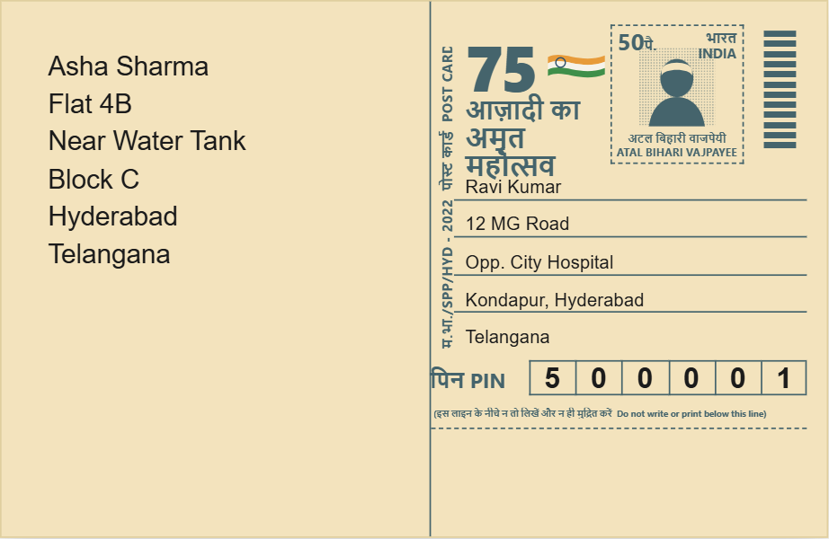
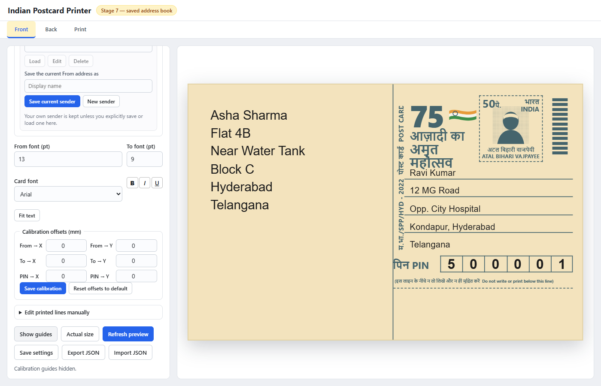
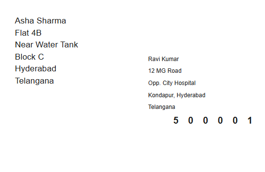
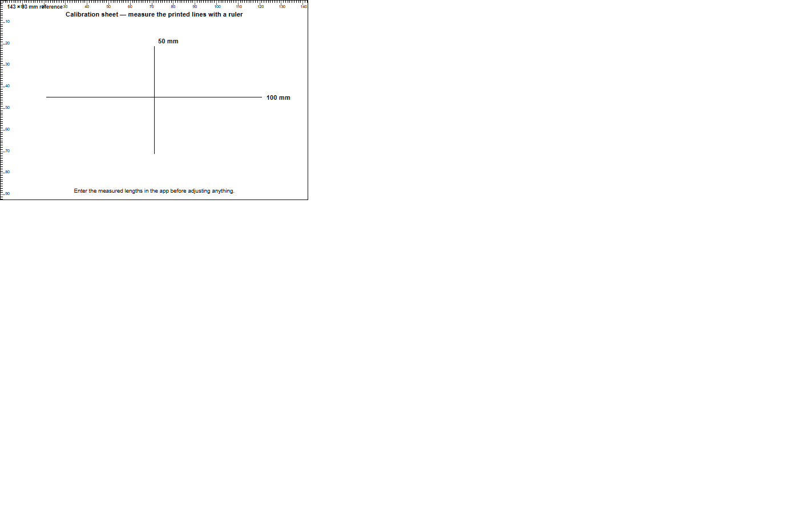
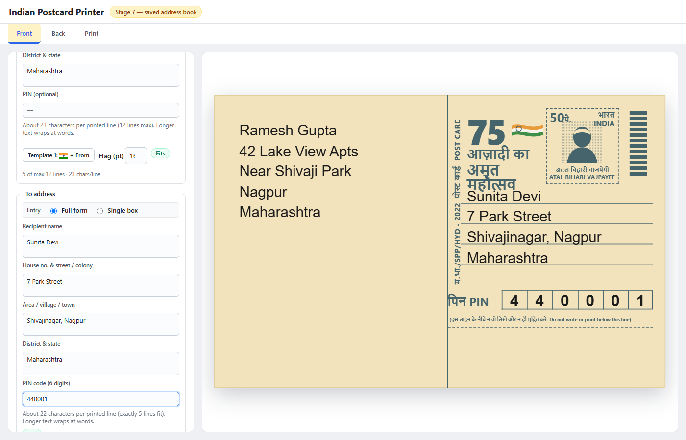
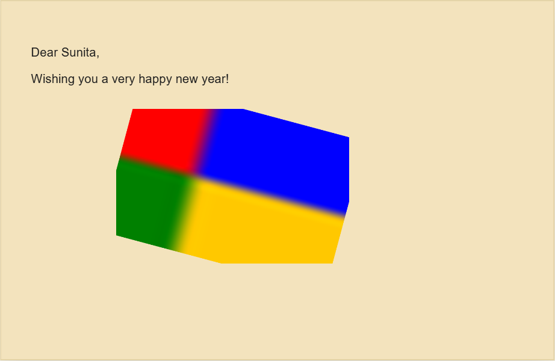
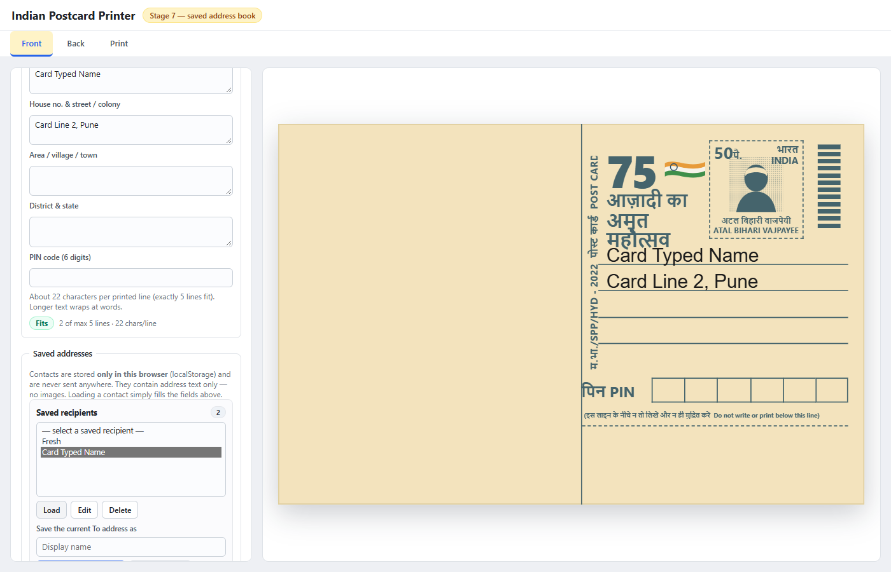

<p align="center">
  <h1 align="center">Indian Postcard Printer</h1>
  <p align="center">
    Compose and print exact-size Indian inland postcards (143 × 93 mm) — front addresses and PIN boxes, blank reverse with an optional image — straight from your browser.
  </p>
</p>

<p align="center">
  
  
  
  
  
</p>

<p align="center">
  <a href="#getting-started">Getting Started</a> ·
  <a href="#usage">Usage</a> ·
  <a href="#printing">Printing</a> ·
  <a href="#tests">Tests</a> ·
  <a href="#known-limitations">Known Limitations</a>
</p>

---

A small, free, open-source Windows utility for composing an Indian inland
postcard (143 × 93 mm): front (addresses + PIN) and back (blank message
side, optional image), with direct exact-size printing.

**Current status: Stage 6** — structured address forms with measured text
fitting, an optional back-side image editor, correct Front / Back /
Front-and-Back print page selection, and the text-only overlay +
calibration sheet from Stage 5.

## Table of Contents

- [Features](#features)
- [Screenshots](#screenshots)
- [Getting Started](#getting-started)
- [Usage](#usage)
- [Printing](#printing)
- [How It Works](#how-it-works)
- [Settings and Privacy](#settings-and-privacy)
- [Tests](#tests)
- [Project Structure](#project-structure)
- [Layout Specification](#layout-specification)
- [Calibration](#calibration)
- [Known Limitations](#known-limitations)
- [License](#license)

## Features

- **Faithful card design** — reproduces the yellow 50 paise inland postcard
  (Atal Bihari Vajpayee, AKAM "Azadi ka Amrit Mahotsav" 2022 issue) with
  cream paper, dark teal ink, bilingual heading, stamp, AKAM logo, sorter
  bars and four printed ruled address lines.
- **Structured address forms** — Name, House no. & street, Area / village /
  town, District & state plus PIN for both sender and recipient. Every
  field accepts multiple lines; empty optional fields are omitted and
  labels never print.
- **Smart text fitting** — words wrap to the measured 57 mm width (never a
  character count), words are never cut in half, and the five-line limit is
  enforced with a visible status: **Fits**, **Too many lines**, **Line too
  wide** or **Outside printable area**. A **Fit text** action picks the
  largest size in 6–20 pt that fits and tells you what it changed.
- **Nine card fonts** with bold / italic / underline, per-address font
  sizes, and calibration offsets per side.
- **Address book** — save senders and recipients; a saved contact stores
  exactly what the card shows, so loading it back reproduces the same card.
  CSV import/export with duplicate and PIN validation warnings. The CSV
  columns are `Contact,Name,House,Building,Street,Area,City,District,State,PIN`
  (`Contact` is the display name); a header row is recommended and its order
  may vary, a headerless file in the nine field columns also imports, quotes
  and line breaks inside values are supported, and export adds a UTF-8 BOM.
- **Back-side image** — upload PNG/JPEG/WebP and control position, size
  (aspect ratio locked), rotation and crop. Images stay in the browser
  session only; pixel data is never saved or uploaded.
- **Three print modes** — text overlay, full card at exact 143 × 93 mm, or
  a calibration sheet.
- **100 % local** — no network requests, no external services, no
  analytics. Everything lives in your browser's `localStorage`.

## Screenshots

| Front card | Full preview |
| --- | --- |
|  |  |

| Text overlay print | Calibration sheet |
| --- | --- |
|  |  |

| Filled-in card | Back side with image |
| --- | --- |
|  |  |

| Address book |
| --- |
|  |

## Getting Started

### Prerequisites

- **Windows 10 / 11**
- **Microsoft Edge or Google Chrome** (any modern browser works)
- **[Node.js](https://nodejs.org/)** — used only for the local dev server
  and the tests. No particular version is required; any recent release works.

There is **nothing to install** — no `npm install`, no dependencies, no
build step. The app is plain HTML + CSS + vanilla JavaScript.

### Installation

1. Clone or download this repository:

   ```powershell
   git clone https://github.com/SR71BlackbirdX/postcard-printer-.git
   ```

2. Open a terminal in the project folder:

   ```powershell
   cd postcard-printer
   ```

That is the entire installation.

### Run the app

Start the built-in dev server (Node's standard `http` module only):

```powershell
node server.js
```

Then open **<http://127.0.0.1:5173/>** in Edge or Chrome. The server binds
to `127.0.0.1` only — it is never exposed to the public network.

**To stop the server:** press **Ctrl+C** in the terminal where it is
running (the port is released immediately).

Notes:

- The default port is **5173**. If it is already occupied, the server stops
  and reports that clearly; it will **not** silently switch ports. To use
  another port on purpose: `$env:PORT=5174; node server.js`
- The server serves only the project folder, returns **404** for missing
  files, **403** for directory-traversal attempts, and **405** for
  non-GET/HEAD methods, and disables caching so your edits always show up.
- You can still double-click `index.html` to open it directly; the server
  is only needed for the localhost URL and for running the browser tests.

### Optional: browser tests

The visual and end-to-end suites use **Playwright**. It is a
development-only, optional tool — the app never needs it. The tests look
for Playwright in the local `node_modules` first, then in the global npm
install:

```powershell
npm install -g playwright
```

No browser download is needed — the suites use the **already-installed
Edge** via Playwright's `channel: "msedge"`.

## Usage

The app has three tabs:

| Tab | What it does |
| --- | --- |
| **Front** | Sender/recipient address forms (or one box each), per-address fonts, nine-family card font with bold/italic/underline, calibration offsets, optional manual line editing; the card itself is editable too — click an address and type. |
| **Back** | Optional message, optional image with full placement controls, message templates. |
| **Print** | Choose Front / Back / Front-and-Back, choose the print mode, see the active offsets, clear saved data. |

**Address forms** use four printed-line fields — **Name**, **House no. &
street / colony**, **Area / village / town**, **District & state** — plus
the PIN. They print as the card's ruled lines: `name` / `house, street` /
`area, city` / `district, state`. Every field accepts multiple lines —
press Enter inside a field and each line keeps its own printed line. The
recipient PIN is not repeated in the address — it belongs in the six boxes,
which you can type straight onto the card. Each address can also be
entered as one box (*Single box* mode).

The card prints **4 ruled lines** (as measured on real stock); a 5th line
is accepted and prints below the last rule. Nothing is silently clipped
and no overlapping lines are ever printed. Template 1's 🇮🇳 line has its
own size (click the flag on the card).

**Back side** — the reverse prints as blank cream paper at exactly
143 × 93 mm unless you add an optional message or an optional image.
Message font size, line spacing and margins are adjustable; overflow is
warned about in the same way as the addresses. Front and back keep
**independent** calibration offsets so the card can be turned over and fed
back through the printer with per-side correction.

**Back-side image** — upload PNG/JPEG/WebP, then control position (X/Y mm),
size (W/H mm) with aspect ratio locked by default, rotation, and crop
percentages. The image is drawn to a high-resolution canvas, so the file is
never re-encoded and quality is preserved. Parts outside the 143 × 93 mm
boundary are clipped and flagged. Images stay in the browser session only —
pixel data is never saved to storage or exported; only placement settings
and the *Print image* flag persist. In text-overlay mode the image prints
only when *Print image* is on.

## Printing

The **Print** tab has two settings — *Side to print* and *Print mode*:

| Mode | Page setup | Output |
| --- | --- | --- |
| **Text overlay** *(default)* | printer's own paper, content at 100% — no scaling | **Only your content**: sender/recipient/PIN text (front) or message + optional image (back). No background, artwork, rules or PIN borders. |
| **Full card** | exact `@page 143mm × 93mm`, margin 0 | The complete card design + text on blank stock. |
| **Calibration sheet** | printer's own paper, 12 mm margin | A 100 mm horizontal line, a 50 mm vertical line and a 143 × 93 mm rectangle. **Test only.** |

**Front and Back** produces two separate 143 × 93 mm pages (front first,
with a forced page break). Most ordinary printers need you to reinsert the
sheet/card manually to print the second side — automatic duplex printing is
not claimed unless your driver supports it and you have tested it.

**Print dialog settings:** choose 100 % / Actual size, disable "Fit to
page", set orientation landscape, and enable background graphics (full-card
mode only).

### Set up the printer once (custom page type, landscape only)

The card is **143 × 93 mm**, which is wider than it is tall — a landscape
page. Most printers do not ship with this size, so add it once in Windows:

1. **Settings → Bluetooth & devices → Printers & scanners** → your printer →
   **Printing preferences** (or **Printer properties → Printing
   preferences**).
2. Open the **Paper/Quality** tab (wording varies by driver) and set
   **Paper size** to **User Defined / Custom**.
3. Create a new page type: **width 143 mm, height 93 mm**. Name it
   `Postcard 143x93` and save it.
4. Still in Printing preferences, set **Orientation → Landscape**, then apply.

Select `Postcard 143x93` as the paper size every time you print; the app
requests the same 143 × 93 mm page from CSS, so the browser and the driver
agree on the size and orientation. If your driver offers a "lock" or "set as
default" option for orientation, use it so portrait can no longer be picked.

**Why this matters:** if the printer stays on A4/Letter portrait, the browser
scales the card to fit and every measurement comes out wrong — this is the
usual cause of a print measuring short. Confirm with the **calibration
sheet** after changing the page type.

### Why the print may measure smaller

Your first print measured **136 × 86 mm** against the 143 × 93 mm target
(width suggests +5.15 %, height +8.14 %). Because the two axes differ, a
uniform scale factor would be a guess — so the app does **not** compensate
automatically. Instead, print the **calibration sheet** and measure:

1. the **100 mm** horizontal line
2. the **50 mm** vertical line
3. the **143 × 93 mm** rectangle

If those also measure short, the browser/printer is scaling uniformly; if
they measure correctly, the problem is the page size or margins instead.
Report the three measurements and the cause can be identified before any
correction is applied.

**Honest limitation:** CSS can only *request* dimensions — printer drivers
may impose unprintable margins or apply their own scaling, and no CSS can
override hardware margins.

## How It Works

### Three layers

The postcard is built as three distinct layers inside `.postcard`:

1. **`.card-artwork`** — the original printed design (never edited; pointer
   events pass through)
2. **`.card-content`** — the editable sender/recipient addresses and the six
   PIN digits
3. **`.card-guides`** — optional calibration aids, hidden by default: the
   guides *and* the mm ruler that runs along the card's top and left edges
   (it looked like a second scrollbar, so it now only appears with the
   "Show guides" button)

### Technology

- HTML + CSS + vanilla JavaScript — no framework, no build step
- Storage: browser `localStorage` + export/import of a JSON settings file
- No database, no cloud service, no paid APIs, no dependencies

### Screen scaling (documented DPI)

The preview uses CSS `mm` units directly. The browser converts them at the
CSS standard resolution of **96 DPI**: `1 mm = 96 / 25.4 = 3.7795` screen
pixels. The window scaling is a CSS `transform: scale()` only — it never
changes the underlying millimetre geometry, so the preview always shows the
true 143 × 93 mm proportions. The **Actual size** button switches the
preview to true physical size for comparison against the real card.

## Settings and Privacy

- **Save settings** stores the form in this browser (`localStorage`).
- **Export JSON** downloads `postcard-printer-settings.json`
  (backup/migration; placement settings only, never image data).
- **Import JSON** restores from that file; invalid files fall back safely
  to defaults — malformed data never breaks the app.
- **Clear saved data** (Print tab) removes everything stored in this
  browser.

Everything is stored locally in your browser — no network requests, no
external services, no uploads:

- **Saved:** address fields, fonts, calibration offsets, message, image
  *placement settings*, the "Print image" flag, and message templates.
- **Never saved:** uploaded image pixels. Images live only in the current
  browser session and must be re-uploaded after reopening the app.

## Tests

With Node.js installed (no `npm install` needed):

```powershell
node --check js\layout.js
node --check js\settings.js
node --check js\address.js
node --check js\addressbook.js
node --check js\preview.js
node --check js\app.js
node --check server.js
node tests\layout.test.js
node tests\address.test.js
node tests\html.smoke.test.js
node tests\addressbook.test.js
node tests\preview.visual.test.js
node tests\e2e.test.js
node tests\addressbook.e2e.test.js
```

Run the browser suites (visual, e2e, address book e2e) one at a time — each
starts its own server.

| Suite | Checks | Needs a browser |
| --- | --- | --- |
| `layout.test.js` | 42 — card size, sections, divider, PIN row/boxes, 5-line capacity vs 4 printed rules, recipient lines and margins, artwork bounds, back layout | no |
| `address.test.js` | 37 — field assembly, omitted optionals, multi-line fields, measured wrapping, word preservation, too-wide words, fit status, Fit-text behaviour | no |
| `html.smoke.test.js` | 18 — element ids (unique), file references, defaults, print button, no image persistence, settings upgrade | no |
| `addressbook.test.js` | 103 — contacts, duplicates, persistence, corrupt data, CSV parse/round-trip/import warnings, PIN validation | no |
| `preview.visual.test.js` | 191 — rendered geometry, artwork, three print modes, side selection, fitting, image editing, address book | yes |
| `e2e.test.js` | 90 — full workflow on a real server + Edge: HTTP behaviour, page/panel scrolling, forms, fitting, back image, templates, 5-line capacity, card PIN typing, font toggles, rulers, calibration, all print modes/sides, settings persistence, export/import | yes |
| `addressbook.e2e.test.js` | 67 — save/load/edit/delete, exact card round-trip (including addresses typed straight onto the card), CSV import/export, reload, corrupt storage | yes |

**Total: 548 checks, 0 failures.**

`layout.test.js` verifies: card size, section widths summing to 143 mm, the
48 mm PIN row, edge-to-edge PIN boxes with zero gaps, the six boxes fitting
the 69 mm recipient section, address-line positions, that the 5th address
line clears the PIN row while only 4 rules print, and that every
printed-artwork element stays inside the card and clear of the measured
geometry.

`html.smoke.test.js` verifies (without a browser) that every element id
referenced from the JavaScript exists in `index.html`, every referenced
file exists, the Print button is present and enabled, and the default
address/PIN values are intact.

`e2e.test.js` starts its own instance of the real `server.js` on a free
port, verifies the HTTP behaviour (types, 404, traversal protection, 405,
no-store headers), then drives the complete user workflow in headless Edge
and saves screenshots to `tests\e2e-shots\` (including true print-media
captures of card, overlay and calibration output) for eyeball review.

The visual test measures the rendered card geometry in the browser
(143 × 93 mm, divider at 74 mm, recipient block at 80 mm / 28.8 mm, PIN row
48 mm wide and touching, 9 pt font), verifies the printed artwork layer and
that the calibration guides are hidden by default, and saves
`tests\preview-full.png` and `tests\postcard.png` for eyeball review. It
divides out the preview's CSS scale factor, so it verifies the true
millimetre geometry rather than the window-fitted size.

## Project Structure

```
postcard-printer/
├── index.html                  # The application window
├── server.js                   # Localhost dev server (Node http module, no dependencies)
├── css/style.css               # Styling; all geometry in mm custom properties
├── js/layout.js                # ALL physical measurements (mm) — single source of truth
├── js/address.js               # Address assembly, measured wrapping, fit status
├── js/addressbook.js           # Contacts, persistence, CSV import/export
├── js/preview.js               # Applies layout to the DOM, scales the preview
├── js/settings.js              # Load/save settings (localStorage + JSON import/export)
├── js/app.js                   # Wires the form, preview and storage together
├── tests/layout.test.js        # Automated layout checks (Node.js)
├── tests/address.test.js       # Address assembly + fit checks (Node.js)
├── tests/addressbook.test.js   # Address book unit checks (Node.js)
├── tests/html.smoke.test.js    # HTML/JS consistency checks (Node.js)
├── tests/preview.visual.test.js# Playwright visual test (optional)
├── tests/e2e.test.js           # Playwright end-to-end workflow (optional)
├── tests/addressbook.e2e.test.js # Playwright address book e2e (optional)
└── README.md
```

## Layout Specification

All physical measurements live in one file — `js/layout.js` — in
millimetres:

| Item | Value |
| --- | --- |
| Card | 143 mm × 93 mm |
| Sender section | 74 mm wide |
| Recipient section | 69 mm wide (74 + 69 = 143) |
| Divider | 74 mm from the card's left edge |
| Default font | 13 pt (adjustable 6–20 pt) |
| Recipient address | 5 lines accepted (text top 28.8 mm so each line sits on its ruled line; **4 printed rules** at 34/40.5/47/53.5, ruler-measured: first rule 6 mm below the stamp, 6.5 mm apart — the 5th line prints below the last rule), PIN row 34 mm below the stamp |
| Recipient margins | 6 mm left / 6 mm right |
| PIN boxes | 6 boxes, 8 mm × 6 mm, **zero gaps** (row = 48 mm) |
| First PIN box | 17 mm from the recipient section's left edge (= 91 mm from card left) |
| PIN row top | 62 mm from the card top |
| PIN default | *(none — the app ships no sample address or PIN)* |

**Sender coordinates are provisional** (8 mm from the left, 8 mm from the
top) because they have not been measured on a real card. The provisional
region is shown by the dashed box in the **guides layer** (click "Show
guides"); it is no longer drawn in the normal preview. The value lives in
one place: `js/layout.js` → `sender`. Set
`sender.coordinatesConfirmed = true` once measured.

## Calibration

The **Calibration offsets** panel shifts the editable content (sender,
recipient, PIN digits) in millimetres, independently on X and Y. The
printed artwork and the base measurements never move — offsets only correct
where your typed content lands relative to the printed card. Offsets are
saved with the other settings and can be reset to 0 with one click.

## Known Limitations

1. **Printer hardware margins are not controllable from CSS.** The driver
   may add unprintable margins or re-scale; the physical calibration test
   on ordinary paper is the only way to confirm real alignment.
2. **Background colour needs "background graphics" enabled** in the print
   dialog; otherwise the card prints without its yellow paper.
3. **Preview ≠ print.** The preview is a layout approximation.
4. **Artwork is approximate** — positions were traced from a photograph,
   not measured. Adjust them in `js/layout.js` → `artwork` if your card
   differs. The stamp portrait is a generic silhouette, not the official
   artwork. The **measured address/PIN geometry is the source of truth**
   and is never derived from the photograph.
5. **Sender position unmeasured** — provisional values, adjustable with the
   calibration controls.
6. **PIN digit size (14 pt) is provisional** — configurable in
   `js/layout.js`.
7. **The 5th recipient line has no printed rule** — the card stock has
   four, and the 5th line prints below the last one, close to the PIN row.
   Four lines keep the intended look.
8. **Browser zoom** changes the apparent screen size; the physical mm
   values are unaffected — use the **Actual size** button when comparing on
   screen.
9. **Automatic duplex is not claimed** — printing both sides means
   reinserting the card manually unless your driver supports it and you
   have tested it.

## License

Free and open-source — use, study, and modify freely.
